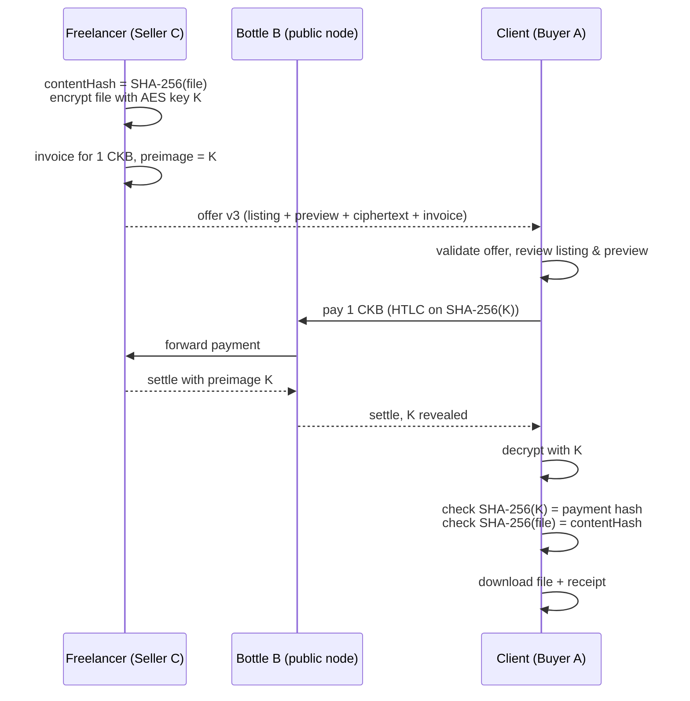

# DevOps Pay-to-Deliver

**Get paid. Prove delivery.**

A freelancer sells a DevOps deliverable (a deploy script, a config file) to a client over the
[Fiber Network](https://www.fiber.world) on CKB Testnet. The freelancer publishes a listing that commits to
the file's SHA-256 hash and shows a free preview, then encrypts the file. The client pays a 1 CKB Fiber
invoice, the payment reveals the decryption key, and the app proves delivery twice: the key matches the
invoice, and the file matches what was listed. Both sides leave with evidence: the freelancer is paid, and
the client has the file plus a proof-of-purchase receipt.

- ▶ Demo video: https://youtu.be/ggoIZLfDcaE
- 🌐 Live demo: https://devops-pay-to-deliver.vercel.app (each visitor funds their own Testnet nodes; the full flow is in the demo video)
- 📄 Basic quest write-up: https://github.com/LORDS-001/ckb-fiber-campaign8-basic

Built for **Build on CKB, Campaign #8 (Advanced quest)** on top of the official Fiber
[Encrypted data payment](https://www.fiber.world/docs/build/encrypted-data-payment) starter kit.

## The problem

Freelance work has a "who goes first" problem. The freelancer doesn't want to hand over the script before
being paid; the client doesn't want to pay for a script they haven't seen.

The starter kit solves half of it: the seller encrypts the content and uses the AES key as the invoice's
payment preimage, so paying the invoice is exactly what reveals the key. But the tutorial's own quiz
("What does payment guarantee?") is clear about the limit: **payment proves the key opens the ciphertext,
not that the content is what the seller promised.** It recommends previews, seller reputation and dispute
rules. This project implements those safeguards on top of the payment:

- a **listing commitment**: the SHA-256 hash of the exact file, published before payment;
- a **free preview**: the first lines of the file, capped so it never gives the work away;
- **automatic verification** after decryption: the key against the invoice, the file against the listing;
- a **proof-of-purchase receipt** the client can hand to a dispute resolver.

## How it works

1. **List.** The freelancer enters a title and pastes text (with a file name) or uploads a file (≤ 64 KB).
2. **Commit.** The app computes `contentHash = SHA-256(file bytes)` and builds a public listing: title,
   file name, type, size, preview and `contentHash`.
3. **Encrypt.** The file bytes are encrypted with a fresh AES-256-GCM key.
4. **Invoice.** The freelancer's node (Seller C) creates a 1 CKB Testnet invoice whose payment preimage *is*
   the AES key, and the app bundles ciphertext, invoice, last-hop hint and listing into an offer (v3 JSON).
5. **Review.** The client (Buyer A) pastes the offer and validates it. The listing, free preview and
   content hash are shown before any money moves.
6. **Locked.** "Decrypt without key" fails: the ciphertext can't be opened without the key.
7. **Pay.** The client pays 1 CKB, routed through the public node **Bottle B** to the freelancer.
8. **Reveal.** Settling the payment reveals the preimage (the AES key) to the client's node.
9. **Decrypt.** The client decrypts the file with the revealed key.
10. **Verify.** Two checks run automatically:
    - ✓ **Key**: `SHA-256(revealed key) == invoice payment hash`
    - ✓ **Content**: `SHA-256(decrypted file) == listing contentHash`
11. **Keep.** The client downloads the file (original name and type) and a proof-of-purchase receipt.



## What I changed from the starter

The first commits ("Initial starter kit (unchanged)") are the official starter as downloaded. Every change
after that is a separate commit:

| Commit | Files | Change |
|---|---|---|
| Add byte encryption and SHA-256 helpers | `lib/crypto.ts` | `encryptBytes(Uint8Array)`, `decryptBytes(payload, key)`, `sha256Hex(bytes)` (Web Crypto). `encryptResult`/`decryptResult` stay as thin text wrappers. |
| Add delivery helpers: preview, download, receipt | `lib/delivery.ts` (new) | 64 KB limit, text-like detection, free preview, browser download, exact CKB formatting, receipt builder. Pure, no runtime imports, so Node tests load it directly. |
| Add listing commitment to offer format (v3) | `lib/offer.ts` | `Listing` and `Deliverable` types; `createOffer` hashes the bytes, builds the preview, then encrypts; invoice description "DevOps Pay-to-Deliver"; `parseOffer` accepts only version 3 and strictly validates the untrusted listing (lengths, MIME type, no paths or control characters, 32-byte hash, and size consistent with the ciphertext length). |
| Rebrand UI as DevOps Pay-to-Deliver with file delivery | `app/page.tsx`, `app/globals.css` | New header and explanation; roles "Freelancer (Seller C)" and "Client (Buyer A)"; listing form with paste-or-upload; sample `deploy.sh`; listing card on the client side before payment; inline text view and "Download <fileName>". |
| Verify key and content after decryption; add receipt download | `app/page.tsx` | "Decrypt & verify delivery" runs both checks and shows a green ✓ or red ✗ for each; "Download proof-of-purchase receipt". |
| Allow starting another offer after a successful payment | `app/page.tsx` | "Start another offer" after **Failed or Success** (was Failed only), resetting the new delivery state. A pending payment still blocks it. |
| Add unit tests for crypto and delivery helpers | `delivery.test.mjs` (new), `package.json` | 11 tests; `npm test` runs both test files. |
| Polish delivery UI after consistency review | `app/page.tsx`, `app/globals.css` | Download buttons use the shared action lock and error display; visible "Free preview" caption; clearer labels; "Start another offer" also resets the listing form to the sample. |

Unchanged on purpose: the payment safety logic (`lib/payment.ts`, `lib/payment-submission.ts`), node and
channel management (`lib/fiber.ts`, `lib/fiber-testnet-runtime.ts`, `lib/channel-funding.ts`,
`lib/node-session.ts`), what may be persisted (`lib/progress.ts`), the cross-origin isolation headers in
`next.config.mjs`, the 1 CKB amount, Testnet only, and Bottle B as the last hop.

## Formats

### Offer v3 (shortened)

The offer is public: it contains only ciphertext, the invoice, a routing hint and the listing.

```json
{
  "version": 3,
  "cipher": "AES-256-GCM",
  "ciphertext": "0x9f2c…e41a",
  "iv": "0x5b1d0c7e9a3f2e8d41c6b0a7",
  "invoice": "fibt1000000001p…",
  "paymentHash": "0x7d3a…c90f",
  "lastHop": { "pubkey": "0x02…", "channel_outpoint": "0x…", "fee_rate": "0x3e8", "tlc_expiry_delta": "0x…" },
  "listing": {
    "title": "Zero-downtime deploy script for client-api",
    "fileName": "deploy.sh",
    "fileType": "text/plain",
    "size": 853,
    "preview": "#!/usr/bin/env bash\n# Zero-downtime blue/green deploy for client-api.\nset -euo pipefail\n…\n… 12 more lines unlock after payment",
    "contentHash": "0x4e1b…a2d7"
  }
}
```

### Proof-of-purchase receipt

Downloaded as `receipt-<first 8 hex chars of the payment hash>.json`:

```json
{
  "kind": "pay-to-deliver-receipt",
  "version": 1,
  "issuedAt": "2026-11-24T18:02:11.512Z",
  "network": "CKB Testnet (Fiber)",
  "listing": { "title": "Zero-downtime deploy script for client-api", "fileName": "deploy.sh", "size": 853, "contentHash": "0x4e1b…a2d7" },
  "payment": { "invoice": "fibt1000000001p…", "paymentHash": "0x7d3a…c90f", "preimage": "0x…", "amountCkb": "1", "feeCkb": "0.001", "status": "Success" },
  "checks": { "keyMatchesPaymentHash": true, "contentMatchesListing": true },
  "note": "The preimage proves payment for this invoice. Anyone holding it can decrypt the matching ciphertext, so share this receipt only with a trusted dispute resolver."
}
```

Anyone can check the receipt: `SHA-256(preimage)` must equal `paymentHash`, and decrypting the offer's
ciphertext with the preimage must yield a file whose SHA-256 is `contentHash`.

## Run locally

Requirements: Node.js **22.18 or newer** and npm.

```sh
npm install
npm run dev
```

Open **http://localhost:3001**. Use `localhost` or HTTPS: the WASM Fiber runtime needs a secure context,
SharedArrayBuffer, Web Locks and cross-origin isolation. `next.config.mjs` supplies the isolation headers;
browser extensions or a proxy that strip those headers can prevent startup.

### Fund and open channels (first run only)

1. Click **Start node** for both the Client (Buyer A) and the Freelancer (Seller C).
2. Copy each funding address into the [Testnet faucet](https://faucet.nervos.org) and request **more than
   500 Testnet CKB per node**: 500 CKB of channel funding plus the on-chain fee. Channel V2 reserves 100 CKB,
   leaving 400 CKB to meet Bottle B's auto-accept minimum.
3. Click **Open 500 CKB channel** on both nodes, then **Refresh channel status** until each shows
   `CHANNEL_READY`. Confirmation can take several minutes.
4. Optional: if the Freelancer's channel shows no inbound liquidity on Bottle's side, use
   **Send / check 5 CKB transfer**. The button checks an existing transfer before sending another.

Keep **one tab per saved node**. Node identities live in browser storage; clearing site data can lose
access to funded channels.

## How to test

1. In the Freelancer panel, keep the sample title and `deploy.sh` (or upload your own file ≤ 64 KB) and
   click **Encrypt & create 1 CKB Invoice**, then **Copy offer**.
2. Paste the offer into the Client panel and click **Validate offer**. The listing card shows the title,
   file, size, content hash and free preview.
3. Click **Decrypt without key**: decryption is rejected.
4. Click **Pay 1 CKB** and wait for `Payment: Success`.
5. Click **Decrypt & verify delivery**: two green checks, the script inline, **Download deploy.sh** and
   **Download proof-of-purchase receipt**.
6. Click **Start another offer** to run again.

**Tamper test.** Create a new offer, and in the Client box change one hex character of
`listing.contentHash` before clicking **Validate offer**. Validate, pay, then decrypt: the key check stays
green but the content check shows **✗ Content mismatch: this file does NOT match the listing commitment**.
(Tampering with the ciphertext instead makes AES-GCM refuse to decrypt at all.)

## Resume and troubleshoot

- After refreshing, start the same saved nodes, revalidate the restored offer, and choose **Check payment
  status**. A completed or pending attempt is never automatically submitted again. An explicit retry is
  available only after the node confirms failure.
- An expired invoice is blocked before recording a new attempt. If the node explicitly rejects submission
  and confirms no payment record exists, the rejected attempt is cleared; choose **Start another offer** to
  create a fresh invoice. Timeouts, worker failures and unavailable status reads keep the attempt locked
  for status checking.
- The decrypted file and the key are kept in memory only. After a refresh, check the payment status to
  recover the key through `getPayment`, then decrypt again.
- If a 5 CKB transfer was interrupted before its hash returned, the button blocks another transfer. Review
  the Freelancer's payment history (`listPayments`) before deliberately clearing its
  `fiber-docs:encrypted-inbound:<seller identifier>` session entry.
- If a channel is slow, check its status or reconnect it. The existing channel is reused. Do not clear its
  storage or fund a replacement to resolve a wait.
- Faucet requests and network confirmations can take longer than expected. Check the faucet transaction
  and refresh the channel status once funds arrive.

## Checks

```sh
npm run typecheck   # TypeScript, strict
npm test            # payment safety tests + delivery/crypto tests (Node test runner)
npm run build       # Next.js production build
```

## Limitations and next steps

- **Listing and offer travel together.** Here the listing is inside the per-buyer offer JSON. A real
  marketplace would publish the listing (and its commitment) once and issue a fresh invoice and ciphertext
  per buyer.
- **The commitment proves sameness, not quality.** It proves the delivered file is exactly the one the
  freelancer listed, not that the script is good. Reputation and dispute rules still matter.
- **64 KB limit.** The ciphertext travels inside the offer JSON as hex. Larger files need off-chain storage
  with only the hash and key exchanged over Fiber.
- **The receipt contains the preimage.** It is proof of payment, but anyone holding it can decrypt the
  matching ciphertext; share it only with a trusted dispute resolver.
- **Testnet only.** Nothing here is meant for real funds.

Ideas:

- **Hold invoices**, so the client can cancel before the freelancer settles if the preview or listing turns
  out wrong.
- **Seller reputation tied to published commitments**: a public history of listings and verified deliveries.
- **Chunked previews with Merkle proofs**: reveal random chunks and prove they belong to the committed file.

## Safety

- Testnet funds only.
- No private keys, seed phrases or `.env` files are in this repository.
- AES keys and decrypted content are never written to `localStorage` or `sessionStorage`; only public offer
  and payment progress is saved (see `lib/progress.ts`). The receipt is only downloaded, never stored.
- Listing fields come from untrusted JSON and are rendered as plain text.

## Credits

Built on the official Fiber [Encrypted data payment](https://www.fiber.world/docs/build/encrypted-data-payment)
starter (`@fiber-pay/sdk`, `@nervosnetwork/fiber-js`).
